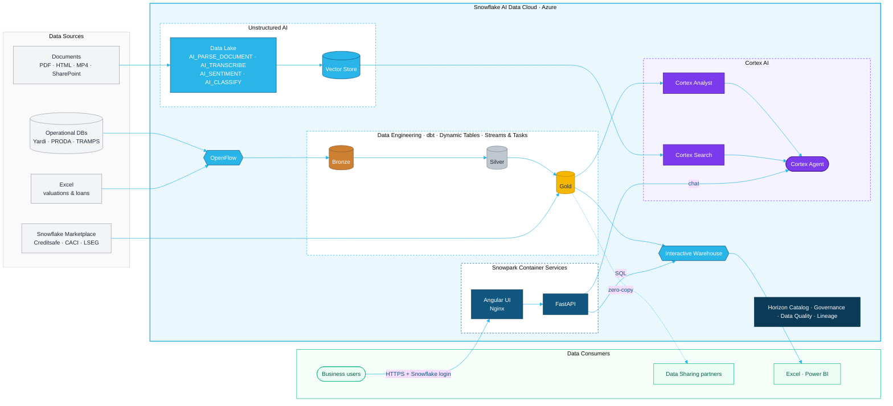

# Shaftsbury360

**Portfolio intelligence for a West End real estate portfolio, built entirely on the Snowflake AI Data Cloud.**

Shaftsbury360 brings portfolio, financial, utility, document and tenant-call data into one governed place. Business users can see the whole estate, spot problems early, and ask questions in plain English.

> This repo uses representative demo data. It is not affiliated with or endorsed by Shaftesbury Capital.

---

## Why Snowflake

| | |
|---|---|
| **One platform, one copy of the data** | Ingestion, transformation, analytics, AI and the app itself all run in the same governed account. There are no separate ETL, vector-database or app-hosting stacks to secure and reconcile. |
| **AI where the data lives** | Cortex Agents, Analyst and Search, plus SQL AI functions (`AI_PARSE_DOCUMENT`, `AI_SENTIMENT`, `AI_CLASSIFY`, `AI_TRANSCRIBE`), work directly on governed tables and documents. Data is never exported to an outside LLM service. |
| **Structured + unstructured together** | Valuations, rent rolls and utility readings sit alongside PDFs, call notes and recordings, so a single question can combine numbers with the text behind them. |
| **Apps without infrastructure** | Snowpark Container Services runs the Angular + FastAPI container next to the data. Snowflake handles login, session tokens, network policies and scaling. |
| **Governance built in** | Horizon Catalog provides role-based access, masking, row-level security, data quality and end-to-end lineage, which supports FCA, AIFMD and SFDR obligations. |
| **Fast for every user** | Interactive Warehouses give dashboards and APIs sub-second responses at high concurrency. |
| **Open and connected** | OpenFlow handles managed ingestion, Marketplace provides third-party data (Creditsafe, CACI, LSEG), and Secure Data Sharing gives zero-copy exchange with lenders, administrators and investors. |
| **Resilient and cost-efficient** | Data is spread across three availability zones per region, with optional cross-region failover. Compute auto-suspends and is billed separately from storage. |

## Business Value

| Outcome | How Shaftsbury360 delivers it |
|---|---|
| **One trusted view of the estate** | Value, buildings, units, ERV and availability come from one governed source, replacing manually assembled spreadsheets. |
| **Faster answers for the business** | Asset managers, finance and IR ask questions in plain English instead of raising requests with the data team. |
| **Lower operating costs** | Utility usage is tracked against budget property by property, and critical overspend (e.g. a building running at ~170% of its electricity budget) is flagged before the bill arrives. |
| **Earlier warning on tenant risk** | AI reads call notes and flags issues such as rent-free requests, service-charge disputes and planning appeals that would otherwise sit in an inbox. |
| **Stronger ESG reporting** | Energy, gas and water data feeds sustainability and net-zero reporting from the same platform as the financials. |
| **Regulatory confidence** | Governed access, lineage and audit trails support FCA, AIFMD and SFDR reporting. |
| **Lower technology overhead** | A single platform replaces separate warehouse, AI, vector-search and app-hosting tools, which means fewer vendors, less integration work and a smaller security surface. |

---

## Architecture



**Request flow:** the browser hits the SPCS public endpoint. Snowflake authenticates the user and applies their network policy. Nginx serves the Angular UI and proxies `/api/*` to FastAPI. FastAPI queries `SHAFTESBURY_DB.APP` through the Interactive Warehouse, or calls `SNOWFLAKE.CORTEX.DATA_AGENT_RUN` for chat. No data leaves Snowflake.

## Features

| Page | What it shows | Snowflake capability |
|---|---|---|
| Dashboard / Portfolio | Headline KPIs: value, buildings, units, ERV, availability | Tables + Interactive Warehouse |
| Destinations | Valuation split by destination | SQL analytics |
| Financials & News | Reported highlights, history, market news | SQL analytics |
| Utilities | Electric / gas / water vs budget, critical alerts, readings | Time-series analytics |
| Documents | Document library | Unstructured data (`AI_PARSE_DOCUMENT`) |
| Calls | Tenant call notes with AI red flags | `AI_SENTIMENT`, `AI_CLASSIFY` |
| AI Assistant | Plain-English Q&A across the portfolio | Cortex Agents, Cortex Analyst, Cortex Search |

## Repository layout

```
backend/            FastAPI app (main.py) and Snowflake connection helper
frontend/           Angular 19 app (pages, chat panel, API service)
Dockerfile          Multi-stage build: Angular -> Nginx + Python runtime
nginx.conf          Serves UI on :8080, proxies /api to FastAPI
supervisord.conf    Runs Nginx and Uvicorn in one container
spec.yaml           SPCS service specification (public endpoint on :8080)
```

## Deploying to Snowflake

Prerequisites: a `SHAFTESBURY_DB.APP` schema with the app tables, a Cortex Agent `SHAFTESBURY_DB.APP.SHAFTESBURY_AGENT`, a compute pool, a warehouse and an image repository.

```bash
docker build --platform linux/amd64 -t shaftsbury360 .
snow spcs image-registry login
docker tag shaftsbury360 <registry_url>/shaftesbury_db/app/shaftesbury_repo/shaftsbury360:latest
docker push <registry_url>/shaftesbury_db/app/shaftesbury_repo/shaftsbury360:latest
```

```sql
CREATE SERVICE SHAFTESBURY_DB.APP.SHAFTSBURY360_SERVICE
  IN COMPUTE POOL SHAFTESBURY_COMPUTE_POOL
  FROM SPECIFICATION_FILE = 'spec.yaml'   -- or inline the spec
  QUERY_WAREHOUSE = SHAFTESBURY_IWH;

SHOW ENDPOINTS IN SERVICE SHAFTESBURY_DB.APP.SHAFTSBURY360_SERVICE;  -- ingress_url
```

## Running locally

```bash
cd backend
pip install -r requirements.txt
export SNOWFLAKE_ACCOUNT=<account> SNOWFLAKE_USER=<user> SNOWFLAKE_PASSWORD=<password>
uvicorn main:app --port 8000

cd ../frontend
npm install
npm start   # proxies /api to localhost:8000 via proxy.conf.json
```

Never commit credentials. Locally, the backend reads them from environment variables. Inside SPCS, it uses the session token that Snowflake mounts into the container.
