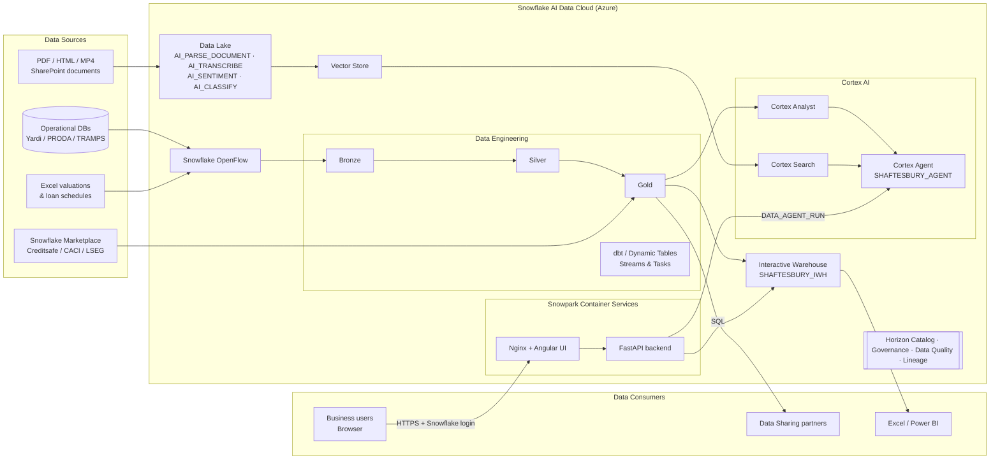

# Shaftsbury360

A portfolio intelligence app for a West End real estate portfolio, built entirely on the **Snowflake AI Data Cloud**. It brings portfolio, financial, utility, document and tenant-call data into one place and lets business users ask questions in plain English through a Cortex Agent.

The app runs as a container in **Snowpark Container Services (SPCS)**: an Angular frontend served by Nginx, and a FastAPI backend that queries Snowflake using the service's own OAuth session token.

> This repo uses representative demo data. It is not affiliated with or endorsed by Shaftesbury Capital.

## Features

| Page | What it shows | Snowflake capability |
|---|---|---|
| Dashboard / Portfolio | Headline KPIs: value, buildings, units, ERV, availability | Tables + Interactive Warehouse |
| Destinations | Valuation split by destination | SQL analytics |
| Financials & News | Reported highlights, history, market news | SQL analytics |
| Utilities | Electric / gas / water vs budget, critical alerts, readings | Time-series analytics |
| Documents | Document library | Unstructured data (`AI_PARSE_DOCUMENT`) |
| Calls | Tenant call notes with AI red flags | `AI_SENTIMENT`, `AI_CLASSIFY` |
| AI Assistant | Plain-English Q&A across the portfolio | Cortex Agents, Cortex Analyst, Cortex Search |

## Architecture



**Request flow:** the browser hits the SPCS public endpoint. Snowflake authenticates the user and applies their network policy. Nginx serves the Angular UI and proxies `/api/*` to FastAPI. FastAPI queries `SHAFTESBURY_DB.APP` through the Interactive Warehouse, or calls `SNOWFLAKE.CORTEX.DATA_AGENT_RUN` for chat. No data leaves Snowflake.

## Why Snowflake

- **One platform, one copy of the data.** Ingestion, transformation, analytics, AI and the application itself all run inside the same governed account, so there are no separate ETL, vector-database or app-hosting stacks to secure and reconcile.
- **AI where the data lives.** Cortex Agents, Analyst and Search, plus SQL AI functions (`AI_PARSE_DOCUMENT`, `AI_SENTIMENT`, `AI_CLASSIFY`, `AI_TRANSCRIBE`), work directly on governed tables and documents. Business users can ask questions in plain English without data being exported to an outside LLM service.
- **Structured and unstructured data together.** Valuations, rent rolls and utility readings sit alongside PDFs, call notes and recordings, so a single question can combine numbers with the text behind them.
- **Apps without infrastructure.** Snowpark Container Services runs this Angular + FastAPI container next to the data, with Snowflake handling authentication, OAuth session tokens, network policies and scaling.
- **Governance built in.** Horizon Catalog provides role-based access, masking, row-level security, data quality monitoring and end-to-end lineage. This matters for FCA, AIFMD and SFDR reporting.
- **Low-latency serving.** Interactive Warehouses give dashboards and API backends sub-second response times at high concurrency.
- **Open and connected.** OpenFlow handles managed ingestion from operational databases and SaaS sources. Snowflake Marketplace provides third-party data (Creditsafe, CACI, LSEG), and Secure Data Sharing provides zero-copy exchange with lenders, administrators and investors.
- **Resilient by default.** Data is spread across three availability zones per cloud region, and cross-region replication and failover are available for business continuity.
- **Pay for what you use.** Compute is separate from storage and suspends automatically, so costs follow actual usage.

## Repository layout

```
backend/            FastAPI app (main.py) and Snowflake connection helper
frontend/           Angular 19 app (pages, chat panel, API service)
Dockerfile          Multi-stage build: Angular -> Nginx + Python runtime
nginx.conf          Serves UI on :8080, proxies /api to FastAPI
supervisord.conf    Runs Nginx and Uvicorn in one container
spec.yaml           SPCS service specification (public endpoint on :8080)
```

## Deploying to Snowflake

Prerequisites: a `SHAFTESBURY_DB.APP` schema with the app tables, a Cortex Agent `SHAFTESBURY_DB.APP.SHAFTESBURY_AGENT`, a compute pool, a warehouse and an image repository.

```bash
# Build and push the image
docker build --platform linux/amd64 -t shaftsbury360 .
snow spcs image-registry login
docker tag shaftsbury360 <registry_url>/shaftesbury_db/app/shaftesbury_repo/shaftsbury360:latest
docker push <registry_url>/shaftesbury_db/app/shaftesbury_repo/shaftsbury360:latest
```

```sql
CREATE SERVICE SHAFTESBURY_DB.APP.SHAFTSBURY360_SERVICE
  IN COMPUTE POOL SHAFTESBURY_COMPUTE_POOL
  FROM SPECIFICATION_FILE = 'spec.yaml'   -- or inline the spec
  QUERY_WAREHOUSE = SHAFTESBURY_IWH;

SHOW ENDPOINTS IN SERVICE SHAFTESBURY_DB.APP.SHAFTSBURY360_SERVICE;  -- ingress_url
```

## Running locally

```bash
cd backend
pip install -r requirements.txt
export SNOWFLAKE_ACCOUNT=<account> SNOWFLAKE_USER=<user> SNOWFLAKE_PASSWORD=<password>
uvicorn main:app --port 8000

cd ../frontend
npm install
npm start   # proxies /api to localhost:8000 via proxy.conf.json
```

Never commit credentials. Locally, the backend reads them from environment variables. Inside SPCS, it uses the session token that Snowflake mounts into the container.
